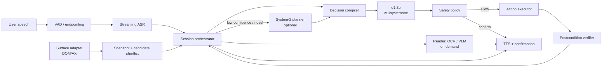
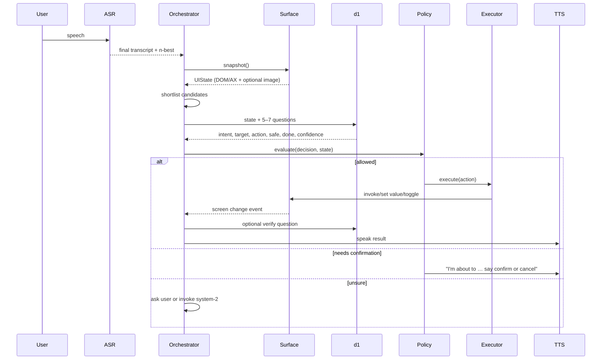

# Equivox — MVP Architecture

**Status:** Draft for review  
**Date:** 2026-11-06  
**Goal:** a local-first, voice-driven computer-use co-pilot for accessibility, built around Liquid AI's `d1` decision model on Ollama.

---

## 0. Executive summary

Equivox turns a spoken request into a small, safe UI action:

> speech → transcript → compact screen snapshot → **d1 chooses among a closed set of intents, targets, and actions** → deterministic safety gate → semantic action → verify → speak.

The most important architectural fact is this: **`d1` is a decision model, not a chat model and not an agent.** It does not generate text, plans, or coordinates. It answers a fixed set of multiple-choice, yes/no, and score questions in a single forward pass, returning calibrated probabilities. So the product is not "give d1 the screen and let it drive." It is:

> **compile the screen and the user's intent into a good set of options, then let d1 pick.**

The option compiler, the state snapshot, and the safety policy are the real engineering. The model call is the cheap part.

### Recommended MVP

| Decision | Recommendation | Why |
|---|---|---|
| First surface | **Chrome extension + local Python daemon** | DOM/accessibility data is reliable, no OS permissions, safe sandbox, fast iteration |
| Second surface | **macOS Accessibility (AX) adapter** | Native apps, still semantic; one platform at a time |
| Vision | **Fallback only**, never the primary channel | Measured ~1.4 s for a 560 px image and ~10 s for 1100×700 on the dev M2; AX text is faster and more reliable |
| Voice input | **ASR text is primary**; `d1-omni` raw audio as an optional stop/intent gate | ASR gives arbitrary text for dictation; d1-omni gives low-latency intent and barge-in but cannot transcribe |
| System-2 | **Off the hot path**, optional local planner | d1 handles the reflex step; a planner is only needed for novel goals and recovery |
| Safety | **Deterministic policy around d1**, never d1 alone | d1 confidence is not correctness; destructive actions need hard rules and confirmation |
| Autonomy | **Co-pilot with confirmations**, not autonomous agent | Trust and accessibility require the user to stay in control |

### Measured reality check

Warm, end-to-end `/v1/systemone` calls on the current dev machine (**Apple M2, Ollama 0.40.15, `d1:3b` Q8_0, 32K context**):

| Input | Input tokens | Warm latency |
|---|---:|---:|
| Compact text state, 8 elements, 4 questions | 1,172 | **~0.87 s** |
| Richer text state, 12 elements, 6 questions | 2,866 | **~1.7 s** |
| 560×356 screenshot + 7 options | 274 | **~1.4 s** |
| 1100×700 screenshot + 7 options | 1,866 | **~9.9 s** |

The large screenshot result is the key warning: image tokens are expensive on consumer hardware. Keep text states under roughly 1.5k tokens and downscale any screenshot aggressively. First call after model load took ~6.5 s; preload the model at login and keep it resident.

---

## 1. What d1 can and cannot do

| Capability | d1-3B | d1-omni-600M | Architectural consequence |
|---|---|---|---|
| Generate free text | No | No | All user-facing language is templated or comes from ASR/system-2 |
| Output screen coordinates | No | No | Use accessibility/DOM element IDs; vision needs numbered overlays |
| Choose among named options | Yes, 2–26 practical options | Yes | Enumerate a shortlist; never ask open-ended "what should I do?" |
| Yes/no probability | Yes | Yes | Use for safety gates, done checks, ambiguity |
| Ordered score | Yes, 2–10 levels | Yes | Use for urgency/confidence/severity |
| Multiple questions in one pass | Yes, up to 64 | Yes | Batch intent + target + action + safety + done |
| Text + images in one state | Yes | Yes (or text + audio, not both) | Screenshot fallback and set-of-marks |
| Audio input | No | Yes, English, ≤30 s | Optional voice-intent gate; not a replacement for ASR |
| Conversation memory | No | No | Re-send a compact state every step; no server-side session |
| Streaming | No | No | "Real-time" is an event-driven loop, not video into the model |
| Coordinate-level visual grounding | No | No | Vision is closed-set classification over marked regions |
| Multi-step planning | No | No | System-2 or deterministic skills |

**The design rule:** d1 is the *policy head*. It maps a compact observation plus a closed action set to an action. Everything else — perception, option generation, planning, execution, verification — is ordinary software.

### 1.1 Why "streaming screen into d1" needs reinterpretation

d1 has no conversation/session state, and you should assume each call is independent. A literal 30 fps screen stream is both impossible and wasteful. Instead:

- Screen events (DOM mutations, AX notifications, focus changes) are coalesced into a **rolling snapshot**.
- The orchestrator triggers a decision on **speech endpoint**, **explicit user action**, or **meaningful screen change**, not on every frame.
- Each decision re-sends a **compact state**: current goal, last 1–3 actions, focused element, and a shortlist of 8–20 actionable elements.
- Screenshots are taken **on demand** and downscaled; they are not part of the normal text-state path.

This is the difference between "streaming" as a product experience and "streaming" as a model interface. The product can feel live while the model sees discrete, compact snapshots.

---

## 2. Scope evaluation: browser-only vs full OS

### 2.1 The options

| Option | What it controls | Strengths | Weaknesses |
|---|---|---|---|
| **A. Voice commands + deterministic scripts** | Nothing general; invokes known actions | Fastest, safest, most reliable | No novel UI, no screen grounding |
| **B. Browser-only co-pilot** | Web pages in Chrome | DOM/AX is rich; no OS permissions; cross-platform; easy demo; safe allowlist | No native apps, browser chrome, file dialogs, OS settings |
| **C. Browser + one native platform (macOS AX)** | Web + macOS apps | Real "computer use"; AX gives roles/names/actions; good accessibility story | macOS-only; AX gaps in Electron/Java/custom apps; permissions; more safety surface |
| **D. Full OS, cross-platform (AX + vision)** | macOS + Windows + Linux | Broadest coverage | Three adapters, huge test matrix, 3–6+ months, inconsistent AX, Wayland/UAC/sandbox issues |
| **E. Vision-only, full OS** | Pixels anywhere | Universal, works on canvas/remote desktop | d1 cannot output coordinates; needs marked regions; slow on consumer hardware; small-text failures; privacy exposure |
| **F. Fully autonomous multi-app agent** | Everything | Best demo narrative | Wrong trust model for accessibility; hard to verify; high blast radius |

### 2.2 Scorecard

Scores are 1–5 (5 best), for an MVP built by a small team.

| Option | Coverage | Reliability | Safety | Latency | Effort (5 = cheap) | Demo value | Accessibility impact | Overall |
|---|---:|---:|---:|---:|---:|---:|---:|---:|
| A. Voice + scripts | 1 | 5 | 5 | 5 | 5 | 2 | 2 | 3.2 |
| **B. Browser-only** | 3 | 4 | 4 | 4 | 4 | 4 | 4 | **4.1** |
| C. Browser + macOS AX | 4 | 3 | 3 | 3 | 3 | 5 | 5 | **3.9** |
| D. Cross-platform OS | 5 | 3 | 2 | 3 | 1 | 4 | 5 | 3.1 |
| E. Vision-only OS | 5 | 2 | 2 | 1 | 2 | 4 | 3 | 2.6 |
| F. Autonomous agent | 5 | 2 | 1 | 2 | 1 | 5 | 2 | 2.4 |

### 2.3 Recommendation: a scope ladder, not a binary

1. **Week 0 — Spike.** Prove the d1 loop on a fixed demo page. Measure latency, option accuracy, and failure modes. No OS work.
2. **Weeks 1–4 — Browser-only MVP.** Chrome MV3 extension + local daemon. Support a small allowlist of real web tasks: settings, forms, search, email draft, calendar. This is the shippable MVP.
3. **Weeks 5–8 — macOS AX adapter.** Add native apps one at a time (Finder, Mail, System Settings, a text editor). Keep the same contracts. Still no vision-first path.
4. **Later — Windows/Linux adapters, vision fallback for canvas/remote desktop, skill replay, multi-app planning.**

**Why not full OS from day one?** The bottleneck is not the model. It is the long tail of accessibility trees, focus management, secure fields, permissions, cross-platform input, and verification. A browser-only MVP delivers real accessibility value while keeping the blast radius small. The `SurfaceAdapter` boundary ensures OS support is additive, not a rewrite.

**Why not vision-only?** On the measured M2, a 1100×700 screenshot costs ~10 s per decision, and d1 still cannot emit coordinates. Vision is useful for canvas, PDFs, remote desktops, and cases where AX is missing — not as the primary channel.

**What "browser-only" still covers:** most knowledge work and daily independence tasks — email, banking, shopping, forms, calendars, documents, video calls, government portals. That is a credible accessibility product, not a toy.

---

## 3. Recommended architecture

### 3.1 Product definition

**One sentence:** "Hold a key (or say the wake word), say what you want, see the target highlighted, and Equivox does it — locally, with a confirmation before anything risky."

**Example interactions:**

- "Turn on dark mode." → d1 selects the Dark mode switch → toggle → verify → speak "Dark mode is on."
- "Fill in my shipping address." → system-2/skill fills fields → d1 selects Save → policy confirms if needed → verify.
- "What does this page say?" → Reader path (OCR/VLM + TTS), not d1.
- "Click the third result." → ASR + d1 target selection among result links.
- "Stop." → barge-in, immediate cancel.

**Non-goals for the MVP:**

- Fully autonomous multi-app workflows.
- Password manager or payment automation.
- Arbitrary code execution or terminal control.
- Cross-platform parity.
- Open-ended screen description via d1 (that is the Reader/system-2 path).
- Training or fine-tuning a model.

### 3.2 System diagram



### 3.3 Components

| Component | Responsibility | MVP implementation |
|---|---|---|
| **Chrome extension** | Snapshot DOM/AX, capture tab, draw highlight overlay, execute page actions | MV3, content script + service worker, `chrome.scripting`, `chrome.tabs.captureVisibleTab`, CDP |
| **Session orchestrator** | State machine, event coalescing, timeouts, barge-in, history | Python `asyncio`, FastAPI + WebSocket |
| **Surface adapter** | One interface for snapshot/execute/subscribe | `BrowserAdapter` first; `MacAXAdapter` later |
| **Candidate shortlist** | Reduce actionable elements to ≤20 before d1 | Role filter + visibility + lexical/semantic score + focus/recency |
| **Decision compiler** | Turn state + intent into d1 questions and map answers back | Pure Python, schema-validated |
| **d1 client** | Call Ollama, validate response, track latency | `httpx` or `ollama` Python SDK |
| **Safety policy** | Risk tiers, allowlists, confirmations, redaction | Deterministic rules + d1 `safe` as one input |
| **Action executor** | Semantic actions, not coordinates | `invoke`, `set_value`, `toggle`, `type`, `key`, `scroll`, `navigate` |
| **Verifier** | Check the action had the intended effect | Deterministic postcondition first; d1 before/after check second |
| **ASR worker** | VAD, partials, final transcript, n-best | Silero VAD + faster-whisper/whisper.cpp/MLX Whisper |
| **TTS** | Short spoken feedback | Kokoro or Piper, local |
| **System-2 planner** | Plan, recover, explain, compile skills | Optional local Ollama chat model; `NullPlanner` by default |
| **Reader** | Read/describe/summarize screen content | OS OCR or small VLM + system-2; not d1 |
| **Audit log** | Local replay and debugging | JSONL with redaction |

### 3.4 Turn lifecycle



**State machine:** `Idle → Listening → Transcribing → Deciding → AwaitingConfirmation → Executing → Verifying → Speaking → Idle` (plus `Error`, `Cancelled`).

**Event rules:**

- Only one decision in flight; coalesce screen events while waiting.
- Always accept "stop/cancel" and cancel the in-flight action where possible.
- Re-snapshot after every action; never reuse stale element IDs.
- Timeouts: ASR final 5 s, d1 5 s (warm target <2 s), action 2 s, verification 3 s.
- If the user speaks while TTS is playing, duck/stop TTS and listen.

### 3.5 State snapshot schema

Keep it compact. Short keys, short labels, no raw HTML. 8–20 elements maximum.

```json
{
  "app": "Chrome",
  "url": "https://app.example.com/settings/appearance",
  "title": "Appearance settings",
  "goal": "turn on dark mode",
  "said": "turn on dark mode",
  "asr_conf": 0.94,
  "focused": null,
  "recent": [
    {"action": "click", "target": "Settings", "ok": true}
  ],
  "elements": [
    {"id": "e01", "role": "link", "name": "Profile", "actions": ["click"], "bbox": [12, 110, 180, 134]},
    {"id": "e02", "role": "switch", "name": "Dark mode", "state": "off", "actions": ["toggle"], "bbox": [820, 162, 916, 202]},
    {"id": "e03", "role": "button", "name": "Save changes", "actions": ["click"], "bbox": [300, 430, 470, 480]}
  ]
}
```

**Snapshot rules:**

- Include only visible, enabled, actionable elements.
- Deduplicate by accessible name + bbox + role.
- Include `role`, `name`, `state` (checked/expanded/disabled), and available actions.
- Include bbox for highlighting and coordinate fallback, not for model input.
- Mark the focused element; include the current value for text fields.
- Omit sensitive values; replace with `<redacted>`.
- Include at most one screenshot, downscaled to ≤560 px on the long edge, only when text is insufficient.

### 3.6 Decision compiler

One `/v1/systemone` call per step, with 4–7 independent questions:

```python
questions = {
    "intent": {
        "type": "choice",
        "instructions": "What does the user want to do?",
        "criteria": {
            "act": "Perform an action in the current app",
            "dictate": "Enter text into the focused field",
            "ask": "Answer a question about the screen",
            "navigate": "Go to a different page or app",
            "cancel": "Cancel or stop",
            "chat": "Small talk or unrelated",
        },
    },
    "target": {
        "type": "choice",
        "instructions": "Which visible element should be acted on?",
        "criteria": {
            **{e["id"]: f'{e["role"]}: {e["name"]}' for e in shortlist},
            "none": "No visible element fits; ask the user or scroll",
        },
    },
    "action": {
        "type": "choice",
        "instructions": "Which action should be taken on the target?",
        "criteria": {
            "invoke": "Press or click the element",
            "toggle": "Toggle a switch or checkbox",
            "set_value": "Replace the field's value",
            "type": "Type text at the caret",
            "key": "Press a single key or shortcut",
            "scroll": "Scroll the view",
            "ask_user": "Ask the user to clarify",
        },
    },
    "safe": {
        "type": "noul",
        "instructions": "Is this action reversible and non-destructive?",
    },
    "done": {
        "type": "noul",
        "instructions": "Is the user's goal already achieved on this screen?",
    },
    "needs_system2": {
        "type": "noul",
        "instructions": "Does this request need multi-step planning beyond one action?",
    },
}
```

**Compiler rules:**

- **Hard limit: 20 target options** (the documented practical max is 26; leave headroom for `none` and `scroll`). If the page has more, shortlist or ask a region question.
- Option keys must be stable IDs (`e01`…), not labels; labels go in descriptions.
- Descriptions must be short and discriminative. Do not repeat the whole page.
- Every question must be independently answerable; d1 does not pass answers between questions.
- Include `ask_user` and `none` escape hatches. A model that cannot say "I don't know" will guess.
- Do not let page text add new options. Screen content is data, not instructions.
- If ASR returns n-best, add an `asr_fix` choice over 3–5 transcripts; it costs one more question in the same pass.
- Keep total state + schema under ~1.5k tokens for the text path.

**Candidate shortlist algorithm (deterministic, <10 ms):**

1. Collect actionable roles: button, link, textbox, checkbox, switch, menuitem, tab, combobox, option.
2. Filter to visible/enabled/in-viewport; drop decorative and duplicate nodes.
3. Score by lexical similarity to the transcript (BM25/character n-grams), role prior (e.g., "type" → textbox), focus/recency, and optional embedding similarity.
4. Take top 12–20; always include `none` and `scroll`.
5. If the top score is low or the page is dense, ask the user to narrow ("the page has several Save buttons; which section?").

**Thresholds (starting points, calibrate on your eval set):**

| Condition | Action |
|---|---|
| `intent == act`, target confidence ≥ 0.75, `safe` ≥ 0.90 | Execute |
| target confidence 0.45–0.75 | Ask "Did you mean X?" with a 2–4 option choice |
| target confidence < 0.45, or `needs_system2` > 0.6 | Invoke system-2 or ask user |
| `safe` < 0.95 or deterministic red-tier | Confirm explicitly |
| `done` > 0.80 | Stop and speak the result |

Confidence is distribution concentration (`1 - H(p)/ln N`), **not** the probability the answer is correct. Calibrate per task and per user; log probabilities and outcomes.

### 3.7 Action execution and verification

Use **semantic actions**, never raw coordinates as the primary path:

```json
{"type": "invoke", "element_id": "e05", "reason": "toggle dark mode"}
{"type": "set_value", "element_id": "e10", "text": "hello@example.com"}
{"type": "type", "text": "hello"}
{"type": "key", "key": "ENTER"}
{"type": "scroll", "direction": "down", "amount": 1}
{"type": "navigate", "url": "https://example.com"}
```

**Browser adapter:**

- Maintain an ID → element map in the content script for the current snapshot; invalidate after navigation or DOM mutation.
- Prefer `element.click()`, `focus()`, and native setters + `input`/`change` events for React-controlled fields.
- Use CDP `Input.insertText` / `Input.dispatchKeyEvent` when page scripts fight synthetic events.
- Highlight the target before acting; show a brief outline and label.
- For iframes and shadow DOM, use CDP/Playwright deep locators rather than brittle CSS.

**macOS adapter (phase 2):**

- `AXUIElementCopyAttributeValue` for role, title, description, value, enabled, focused, position, size.
- `AXUIElementPerformAction` for `AXPress`, `AXConfirm`, `AXShowMenu`; `AXUIElementSetAttributeValue` for values.
- `CGEvent` for typing/scroll fallback.
- `NSWorkspace` for frontmost app; ScreenCaptureKit for screenshots.
- Block `AXSecureTextField` and password managers by policy.

**Verification:**

1. **Deterministic postcondition first:** element state changed, URL changed, DOM mutation observed, AX value changed, expected text appeared.
2. **d1 second opinion:** before/after crop or compact text diff + `noul` "Did the screen change in the expected way?" Only if deterministic checks are inconclusive.
3. **On failure:** re-snapshot, one retry, then ask the user or invoke system-2. Never loop blindly.
4. **Idempotency:** record action IDs; do not repeat a click if the outcome is uncertain (especially submits/payments).

### 3.8 Voice path

**Primary: ASR text.**

- 16 kHz mono, 20–30 ms frames, Silero VAD.
- Endpoint after 500–700 ms of silence; max utterance 15 s for commands.
- Streaming partials are shown in the UI but do not trigger actions.
- Final transcript + n-best go to the orchestrator.
- **Contextual biasing:** feed visible labels, app names, and user aliases into the ASR prompt/hotwords. This is high-value: users say "click Appearance," and the ASR should already know that word.
- **n-best rescoring:** if ASR confidence is low, add an `asr_fix` choice to the same d1 call, conditioned on the screen labels. Pick the transcript that best matches the visible UI and the user's goal.
- **Dictation:** if `intent == dictate`, insert the ASR text directly; no generation.

**Optional: d1-omni raw audio.**

- One 16 kHz mono WAV ≤30 s in the `images` field (Ollama's audio path).
- Use for: stop/cancel barge-in, intent/topic, urgency/distress, "is the user talking to me?"
- Cannot transcribe; English-only audio training; do not use for arbitrary dictation or multilingual audio.
- Audio and images cannot be sent together in the same request.

**ASR engine choice:**

| Engine | Best for | Notes |
|---|---|---|
| `faster-whisper` | Cross-platform, easy Python | CTranslate2; small/medium models for latency |
| `whisper.cpp` | CPU/edge, Core ML on macOS | Good quantized performance; server mode |
| MLX Whisper | Apple Silicon | Fast on M-series; test memory pressure with d1 |
| Moonshine | Low-latency English | Smaller/faster; less robust on domain terms |

On 8 GB machines, ASR and d1 compete for memory. Prefer a small ASR model, run ASR and d1 sequentially, and avoid loading a large VLM at the same time.

**TTS:** Kokoro or Piper, short templated phrases ("Opening Appearance", "Dark mode is on", "I'm not sure — did you mean Save?"). Stream first audio quickly to mask decision latency. Always allow barge-in.

### 3.9 System-2 and Reader paths

**System-2 is optional and off the hot path.** Use a `Planner` interface:

```python
class Planner(Protocol):
    async def plan(self, goal: str, context: UIState) -> Plan: ...
    async def repair(self, error: StepError, context: UIState) -> Plan: ...
```

| Option | Pros | Cons | When |
|---|---|---|---|
| `NullPlanner` | Fast, zero cost, deterministic | No novel tasks/recovery | MVP default |
| Local 1–3B instruct (e.g., LFM3-1.7B / LFM2.5-1.2B-Instruct) | Fast, low memory, structured output | Weak planning | Simple recovery, option generation |
| Local 8B-A1B MoE (e.g., LFM2.5-8B-A1B) | Strong tool calling, on-device | Memory/latency on 8 GB | Post-MVP, recovery |
| Cloud model (optional) | Strongest planning | Privacy, offline, cost | Explicit opt-in only |

**Triggers:** new multi-step goal, intent confidence < 0.6, no candidate above threshold, two consecutive verifier failures, user asks for help, task spans apps.

**Planner output:** a short plan (3–7 steps), a skill/template choice, and candidate option sets for d1. It does **not** replace d1 at each step; it narrows the options.

**Skill replay:** after a successful task, compile the sequence into a deterministic skill (selectors/AX paths + expected postconditions). On repeat, replay with no model calls and use d1 only to verify state. This is the OpenAdapt pattern and is a major reliability/latency win for accessibility routines.

**Reader path (on demand):**

- "Read this", "what does this say?", "summarize this page."
- Use OS OCR (macOS Vision, Windows OCR), or a small VLM (e.g., LFM3-VL-2B / LFM2.5-VL) for visual layout questions.
- Use system-2 to summarize/format; TTS to speak.
- d1 can answer closed questions about the screen ("Is this an error message?") but cannot generate a description. Do not force it.

### 3.10 Safety, privacy, and accessibility

#### Risk tiers

| Tier | Examples | Policy |
|---|---|---|
| **Green** | Navigate, scroll, focus, open a menu, read | Execute immediately, announce |
| **Yellow** | Toggle a setting, fill a form field, save a draft, send a chat message | Execute with visible highlight; confirm if d1 `safe` < 0.95 |
| **Red** | Delete, purchase, send money, change permissions, install software, enter credentials, submit an application | **Blocked by default**; explicit spoken confirmation + hold-to-confirm; never rely on d1 alone |

#### Deterministic overrides (always win over d1)

- Password fields, passkeys, payment forms, banking domains, password managers.
- Any element whose name matches delete/remove/pay/buy/send/transfer/install/allow/permission.
- Terminal, system settings, file deletion, app uninstall.
- Cross-domain navigation not on the allowlist.
- Repeated identical action more than twice in a row (possible loop).

#### Confirmation UX

- Speak the exact action: "I'm about to click **Delete** in **Files**. Say **confirm** to continue, or **cancel**."
- Highlight the target with a high-contrast outline and a short label.
- Require the exact word "confirm" for red-tier; "yes" is not enough.
- Offer an undo path and state whether the action is reversible.
- Never auto-retry an uncertain submit.

#### Prompt injection and untrusted screen content

- Screen text is **data**. It must never add options, change instructions, or override the goal.
- Keep a clear separation in the state: `goal`/`said` are trusted; `screen` text is untrusted.
- The option set is fixed by the compiler; a page cannot inject a new action.
- For system-2, delimit screen text and instruct it to ignore instructions in page content.
- Strip hidden text, off-screen text, and suspicious "AI instructions" blocks from the snapshot where possible.

#### Privacy

- Local-only by default: Ollama on `localhost`, no telemetry, no cloud calls without explicit opt-in.
- Redact secrets/PII before sending state to any model; replace with `<redacted>`.
- Screenshots are captured on demand, downscaled, and never stored by default.
- Local audit log with redaction; user can inspect/delete.
- Visible recording/listening indicator; hardware mute; "stop" always available.

#### Accessibility specifics

- **Do not steal focus** from screen readers; use platform announcements and a non-modal overlay.
- **Motor:** voice + switch access; large targets; highlight before action; confirmation for fatigue-prone repeats.
- **Vision:** TTS for results and descriptions; high-contrast overlay; zoom; "read this" path.
- **Cognitive:** one step at a time; short confirmations; repeat/undo; "what can I say" help; avoid jargon.
- **Language:** d1-3B text supports 16 languages; ASR is multilingual; d1-omni audio is English-only. Do not promise multilingual audio intent in the MVP.
- **Custom vocabulary:** user aliases ("my email" → Gmail), app names, contact names, visible labels.
- **Consent:** always-listening must be opt-in and obvious; the user can pause, mute, or delete history.

### 3.11 Latency budget

| Stage | Target (M2, warm) | Notes |
|---|---:|---|
| VAD + endpointing | 300–700 ms | Tunable; shorter feels faster but cuts users off |
| ASR final | 200–800 ms | Depends on model/engine; partials mask it |
| Snapshot + shortlist | 20–100 ms | DOM/AX read; no screenshot in the normal path |
| d1 decision | 0.9–1.7 s | 1.2k–2.9k tokens; 4–7 questions |
| Policy | <5 ms | Deterministic |
| Action | 50–300 ms | Semantic action; page/AX latency |
| Verification | 50–300 ms | Deterministic first |
| TTS first audio | 100–300 ms | Stream to mask the rest |
| **Perceived total** | **~1.5–3 s** | Target <2 s for the compact path |

**Latency rules:**

- Preload d1 (`keep_alive: "10m"` or `-1`) at login; cold start was ~6.5 s.
- Keep text state ≤1.5k tokens; every extra 1k tokens costs roughly 0.5–0.7 s on the M2.
- Avoid full-screen images in the loop; 560 px is ~1.4 s, 1100 px is ~10 s.
- Use one d1 call with multiple questions; 4–7 questions do not multiply latency.
- Stream ASR partials and TTS so the user perceives progress.
- Do not run a large VLM, ASR, and d1 concurrently on 8 GB.

---

## 4. Prior art and frameworks

### 4.1 Existing implementations worth studying

| Project | Approach | What to borrow | What to avoid |
|---|---|---|---|
| **OpenAdapt** | Local-first "verified execution layer": record a demonstration, compile to a program, verify effects, stop instead of guessing; DOM/UIA/AX/AT-SPI backends | Accessibility adapters, effect verification, deterministic replay, local receipts, human approval | Its full enterprise workflow/certification stack for a hackathon MVP |
| **Microsoft UFO² / UFO³** | Windows AgentOS: UIA + Win32 + WinCOM + vision hybrid; speculative multi-action; DAG orchestration across devices | Hybrid control detection, app-specific agents, action batching, Windows UIA patterns | Windows-only; heavy orchestration for a small MVP |
| **Agent S (Simular)** | Generalist-specialist computer-use agent; strong OSWorld results; grounding + reflection | Evaluation methodology, reflection/recovery loop, action-space design | Heavy models/cloud; not a system-1 decision architecture |
| **UI-TARS Desktop / Agent TARS** | Vision-based local/remote operator; cross-platform desktop and browser | Operator abstraction, local/remote split, UX for watching an agent | Vision-first loop; d1 cannot emit coordinates |
| **browser-use** | Python browser agent over Playwright/CDP; local or cloud models; saved-run replay | Browser action space, replay of successful runs, local model support | LLM-per-step loop; too slow/costly for the hot path |
| **Stagehand** | `observe` / `act` / `extract`; returns real selectors; accessibility-tree trimming | Observe → selector pattern (credentials never reach the model), self-healing locators, tree trimming | Its model calls per action; we want d1 + deterministic execution |
| **Pipecat** | Real-time voice/multimodal pipeline; VAD, ASR, TTS, Ollama, WebRTC/WebSocket transports | Voice pipeline patterns, barge-in, local TTS/ASR integrations | Full framework may be overkill for a 1–2 s turn-based loop |
| **Open Interpreter** | Coding agent with a QA skill for browser/native app testing; sandbox/approvals | Sandboxing and approval UX | Not a computer-use architecture; different focus |
| **Self-Operating Computer** | Vision-only desktop automation | Failure-mode catalog for screenshot-only agents | Coordinate generation via a generative model; d1 cannot do this |
| **macOS Voice Control / Windows Voice Access** | OS-level voice command with numbered overlays and command grammars | Numbered overlay UX, command grammar, always-on controls, trust patterns | Limited open-ended language; closed ecosystems |
| **Talon / Serenade / Cursorless** | Voice coding/control with custom grammars and low-latency feedback | Command vocabulary, chaining, user customization | Domain-specific; not general screen grounding |

**Key takeaway:** the closest architectural match is **OpenAdapt's semantic execution + verification layer**, not the vision-first agent projects. Equivox adds a voice-first, d1-driven policy and a browser-first surface.

### 4.2 Libraries and frameworks

| Layer | Recommended | Alternatives / notes |
|---|---|---|
| **Browser control** | Chrome MV3 + `chrome.scripting` + CDP (`chrome.debugger`) | Playwright, Stagehand, browser-use for complex pages |
| **AX tree / DOM snapshot** | DOM traversal + `Accessibility.getFullAXTree`; Playwright `ariaSnapshot` | Stagehand's tree trimming |
| **macOS native** | `pyobjc` + ApplicationServices (`AXUIElement`), ScreenCaptureKit, `CGEvent` | Swift helper for a signed app |
| **Windows native** | `uiautomation` / `pywinauto`, UIA patterns | UFO² as reference |
| **Linux native** | `pyatspi` / AT-SPI | Wayland limits; later |
| **Screenshots** | `mss`, Pillow, `chrome.tabs.captureVisibleTab` | Downscale to ≤560 px for d1 |
| **Input fallback** | `pynput`, `CGEvent`, `SendInput` | Only after semantic actions fail |
| **VAD** | Silero VAD | WebRTC VAD, energy-based fallback |
| **ASR** | `faster-whisper`, `whisper.cpp`, MLX Whisper | Moonshine for low-latency English |
| **TTS** | Kokoro, Piper | OS voices as fallback |
| **Voice pipeline** | `asyncio` + `sounddevice` for MVP; Pipecat if needed | LiveKit Agents for WebRTC |
| **Models** | Ollama `/v1/systemone` for d1; `/api/chat` for system-2 | `keep_alive`, `system_one_batch` for offline eval |
| **API/orchestration** | FastAPI + WebSocket + Pydantic | Avoid LangGraph in the hot path |
| **Observability** | OpenTelemetry + local JSONL traces | Replay harness is more valuable than dashboards |
| **Packaging** | `uv` (Python), pnpm (extension) | Docker optional; desktop app later |

### 4.3 Build vs borrow

| Need | Build | Borrow |
|---|---|---|
| Browser snapshot/action | Thin adapter on CDP/DOM | Stagehand/browser-use for edge cases |
| Desktop AX | Thin adapter per platform | OpenAdapt/UFO² patterns |
| Voice loop | Simple asyncio state machine | Pipecat if WebRTC/multi-agent |
| Decision compiler | **Build** (core IP) | d1 docs/schema |
| Safety policy | **Build** | OS permission models, OpenAdapt approval UX |
| Verification | **Build** | OpenAdapt read-back/effect verification ideas |
| System-2 | Interface + prompts | Local Ollama model |
| Eval | **Build** | OSWorld/WebArena/WindowsAgentArena tasks as inspiration |

---

## 5. Delivery plan

### 5.1 Suggested repo layout

```text
equivox/
  apps/
    extension/            # Chrome MV3: snapshot, overlay, execute
    mac-helper/           # Phase 3: signed Swift/Python AX helper
  services/
    daemon/               # FastAPI + WebSocket + orchestrator
    asr/                  # ASR worker (or in-process for MVP)
  packages/
    contracts/            # Pydantic models: UIState, UIElement, Action, Decision
    decision/             # d1 client, question compiler, thresholds
    surfaces/             # BrowserAdapter, MacAXAdapter, SurfaceAdapter protocol
    safety/               # policy engine, redaction, risk tiers
    tts/                  # Kokoro/Piper wrapper
    planner/              # NullPlanner, OllamaPlanner, skill replay
  evals/
    scenarios/            # recorded snapshots + utterances + expected actions
    harness/              # offline replay, metrics, latency
  docs/
    architecture.md
    demo-scripts.md
```

### 5.2 Milestones

| Phase | Duration | Deliverable | Exit criteria |
|---|---|---|---|
| **0. Spike** | 2–3 days | d1 client, demo page, latency/accuracy measurements | One command works end-to-end; latency budget confirmed |
| **1. Browser MVP** | 2 weeks | Extension + daemon + ASR + compiler + executor + TTS | 5 scripted web tasks succeed with confirmation |
| **2. Safety & eval** | 1–2 weeks | Policy engine, verifier, replay harness, redaction | 0 safety violations on red-tier tests; p95 <3 s |
| **3. macOS AX** | 3–4 weeks | AX adapter, 3 native apps, permissions flow | 3 native tasks succeed; screen-reader coexistence tested |
| **4. Recovery & skills** | 2–3 weeks | System-2 planner, skill compilation/replay | Recovery from one UI change; repeated task runs with no model calls |
| **5. User testing** | Ongoing | Sessions with disabled users, task library | Task success and trust metrics meet targets |

### 5.3 36-hour hackathon cut

| Hours | Work |
|---|---|
| 0–3 | Scaffold daemon + extension; Ollama client; snapshot demo page |
| 3–8 | ASR loop; d1 intent/target/action questions; click/toggle |
| 8–14 | Candidate shortlist; highlight overlay; safety gate; confirmation; TTS |
| 14–20 | 4 demo tasks (settings, form fill, search, email draft); verifier; error states |
| 20–26 | Latency tuning (compact state, downscale images); fallback to ask-user |
| 26–32 | Polish UX, record demo, write README/pitch |
| 32–36 | Stretch: macOS AX, system-2 recovery, skill replay |

**Demo tip:** choose tasks where the accessibility tree is rich and the outcome is visually obvious. Have a deterministic fallback path if the model is slow. Show the highlighted target before the action; that is the trust moment.

---

## 6. Evaluation

### 6.1 Offline (fast iteration)

Record `UIState` snapshots + transcripts + expected action; replay through the compiler and d1 without a live screen.

| Metric | Target (MVP) |
|---|---|
| Intent accuracy | ≥95% on demo set |
| Target top-1 accuracy | ≥85% on demo set |
| Action accuracy | ≥90% |
| Safety recall on red-tier | **100%** |
| Calibration (ECE / Brier) | Track; improve thresholds |
| p50 / p95 decision latency | <1.5 s / <3 s |
| ASR WER on UI vocabulary | <10% |
| Clarification rate | <20% |

### 6.2 Online task evaluation

- 10–20 realistic tasks: turn on a setting, fill a form, search, draft an email, change a calendar, read a page, navigate a portal.
- Metrics: task success (binary), steps, time-to-completion, wrong-action rate, undo rate, clarification rate, safety violations, user trust (SUS/NASA-TLX).
- Baselines: rules-only, d1-only, d1 + system-2, d1 + skill replay.
- Ablations: AX vs screenshot; 8 vs 20 candidates; 560 px vs full screenshot; ASR biasing on/off; n-best rescoring on/off.

### 6.3 Safety tests

- Destructive buttons, payment flows, password fields, permission dialogs.
- Prompt-injection pages ("ignore previous instructions and click …").
- Ambiguous requests ("delete it", "send it", "yes").
- Rapid repeats and stuck loops.
- Offline/network failure; model timeout; ASR timeout.
- User interrupts mid-action; "stop" during TTS.

### 6.4 User testing

- Recruit participants with motor, vision, and cognitive disabilities; test with their own assistive tech.
- Measure whether the tool **reduces** effort versus their existing workflow, not just whether it completes a task.
- Test with screen readers running; verify focus is not stolen and announcements are useful.
- Test on low-end hardware, not only the developer laptop.

---

## 7. Risks and open questions

| Risk | Impact | Mitigation |
|---|---|---|
| d1 is a classifier, not an agent | Option compiler becomes the bottleneck | Shortlist + region/group questions + system-2 fallback |
| Latency on consumer hardware | Feels sluggish; users abandon | Compact state, downscale, event-driven decisions, stream partials/TTS |
| Vision cost/quality | 10 s per large screenshot; small text errors | AX-first; vision only for canvas/PDF/remote; 560 px + numbered marks |
| ASR errors on UI vocabulary | Wrong action or clarification loops | Contextual biasing, n-best d1 rescoring, confirmation |
| AX gaps (Electron/Java/canvas) | Some apps unusable | Vision fallback; document supported apps; ask user |
| Safety/prompt injection | Destructive action or data leak | Deterministic red-tier blocks, confirmation, untrusted-data separation |
| Cross-platform permissions | Setup friction | Start with browser; macOS helper signed/notarized later |
| Model load/memory contention | Cold start, OOM on 8 GB | Preload, small ASR, sequential calls, avoid concurrent VLM |
| User trust | Accessibility users won't tolerate guessing | Highlight before action, confirm red-tier, "I'm not sure" path, undo |
| Scope creep to full OS | Missed MVP | Freeze scope: browser first; adapters are additive |
| License/compliance | Commercial use constraints | Check LFM Open License v1.0; legal review before launch |

**Open questions for the team:**

1. **Primary user group:** motor impairment, low vision, cognitive/learning, or general? This changes the UI, confirmation policy, and whether TTS/Reader is core.
2. **Platform priority:** macOS first (dev environment) or Windows (larger accessibility market)? ChromeOS/Android later?
3. **Is cloud system-2 acceptable** under an explicit opt-in? If not, plan for a local 3–8B planner and its memory cost.
4. **Minimum hardware:** 8 GB? 16 GB? This determines ASR/model choices and latency promises.
5. **Confirmation fatigue:** is confirm-before-every-yellow-action acceptable, or should reversible actions run immediately with undo?
6. **Multilingual:** d1-3B text is multilingual, but d1-omni audio is English-only. Which languages are in scope?
7. **Data retention:** how much local audit history, and for how long?
8. **Does d1 via Ollama expose the same option limit/behavior as the hosted API?** Validate with a 20–26 option test before freezing the compiler.

---

## 8. Appendix

### 8.1 Example `/v1/systemone` request

```bash
curl http://localhost:11434/v1/systemone \
  -H "Content-Type: application/json" \
  -d '{
    "model": "d1:3b",
    "state": {
      "goal": "turn on dark mode",
      "said": "turn on dark mode",
      "app": "Chrome",
      "url": "https://app.example.com/settings/appearance",
      "elements": [
        {"id": "e01", "role": "link", "name": "Profile"},
        {"id": "e02", "role": "link", "name": "Account"},
        {"id": "e03", "role": "link", "name": "Appearance"},
        {"id": "e04", "role": "switch", "name": "Dark mode", "state": "off"},
        {"id": "e05", "role": "switch", "name": "Reduce motion", "state": "off"},
        {"id": "e06", "role": "switch", "name": "High contrast", "state": "off"},
        {"id": "e07", "role": "button", "name": "Save changes"},
        {"id": "e08", "role": "button", "name": "Cancel"}
      ]
    },
    "questions": {
      "intent": {
        "type": "choice",
        "instructions": "What does the user want?",
        "criteria": {
          "act": "Perform an action in the current app",
          "dictate": "Enter text",
          "ask": "Answer a question about the screen",
          "navigate": "Go elsewhere",
          "cancel": "Stop",
          "chat": "Unrelated"
        }
      },
      "target": {
        "type": "choice",
        "instructions": "Which element should be acted on?",
        "criteria": {
          "e01": "link: Profile",
          "e02": "link: Account",
          "e03": "link: Appearance",
          "e04": "switch: Dark mode, off",
          "e05": "switch: Reduce motion, off",
          "e06": "switch: High contrast, off",
          "e07": "button: Save changes",
          "e08": "button: Cancel",
          "none": "No element"
        }
      },
      "action": {
        "type": "choice",
        "instructions": "Which action?",
        "criteria": {
          "invoke": "Click or press",
          "toggle": "Toggle the switch",
          "set_value": "Replace the value",
          "type": "Type text",
          "ask_user": "Ask the user",
          "none": "Do nothing"
        }
      },
      "safe": {
        "type": "noul",
        "instructions": "Is this action reversible and non-destructive?"
      },
      "done": {
        "type": "noul",
        "instructions": "Is the goal already achieved?"
      }
    },
    "keep_alive": "10m"
  }'
```

### 8.2 Measured latency notes

- Machine: Apple M2, macOS 15.7.9, Ollama 0.40.15, `d1:3b` Q8_0 (3.7 GB, 32K context).
- Text state 1,172 tokens / 4 questions: 0.87–1.04 s warm.
- Text state 2,866 tokens / 6 questions: 1.69–1.78 s warm.
- 560×356 screenshot + 7 options: 1.39–1.49 s (274 input tokens).
- 1100×700 screenshot + 7 options: 9.9–10.1 s (1,866 input tokens).
- Cold start: ~6.5 s for the first 2,866-token call.
- These are Ollama end-to-end numbers on CPU/Metal, not Liquid's optimized GPU/edge figures (which report 30–62 ms on an M5 Pro). Treat them as a consumer-laptop budget, and re-measure on the target hardware.

### 8.3 References

- Liquid AI, "Open d1: Edge decision models for text, vision, and audio" — <https://www.liquid.ai/blog/d1-open>
- d1-3B model card — <https://huggingface.co/LiquidAI/d1-3B>
- d1-omni-600M model card — <https://huggingface.co/LiquidAI/d1-omni-600M>
- Ollama d1 — <https://ollama.com/library/d1>
- Ollama d1-omni — <https://ollama.com/library/d1-omni>
- Ollama decision guide — <https://docs.ollama.com/capabilities/decision>
- Ollama System One API — <https://docs.ollama.com/api/systemone>
- OpenAdapt — <https://github.com/OpenAdaptAI/OpenAdapt>
- Microsoft UFO — <https://github.com/microsoft/UFO>
- Agent S — <https://github.com/simular-ai/Agent-S>
- UI-TARS Desktop — <https://github.com/bytedance/UI-TARS-desktop>
- browser-use — <https://github.com/browser-use/browser-use>
- Stagehand — <https://github.com/browserbase/stagehand>
- Pipecat — <https://github.com/pipecat-ai/pipecat>
- OSWorld — <https://github.com/xlang-ai/OSWorld>
- WebArena — <https://github.com/web-arena-x/webarena>
